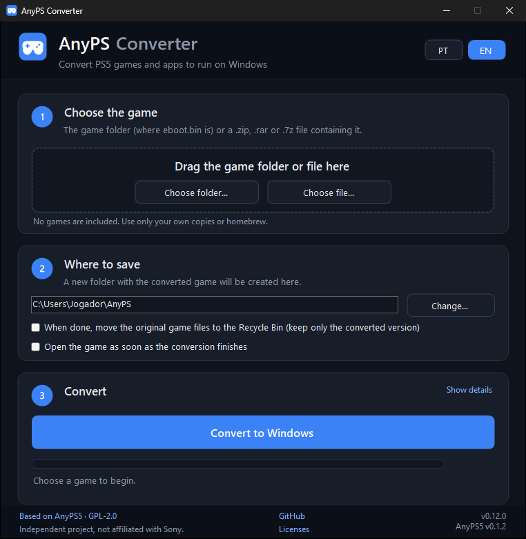

# AnyPS Conversor

[](https://github.com/LeoFeitosa/anyps-conversor/actions/workflows/build.yml)
[](https://github.com/LeoFeitosa/anyps-conversor/releases/latest)
[](LICENSE)

A Windows GUI that converts PS5 games and apps into Windows executables, with no command line.
Choose the game folder, click **Convert to Windows** and, at the end, **Play now**.

[Português](README.md) | **English**

**[⬇ Download the latest version (AnyPS-Conversor.exe)](https://github.com/LeoFeitosa/anyps-conversor/releases/latest/download/AnyPS-Conversor.exe)**



## Based on AnyPS5

This project is a front end for [AnyPS5](https://github.com/boykopovar/AnyPS5), by
[boykopovar](https://github.com/boykopovar) and contributors. All the heavy lifting is theirs: the
relinker that turns the PS5 executable into a native one and the reimplemented system libraries.
AnyPS Conversor only puts those pieces together in a program anyone can use:

| Part | Source |
|---|---|
| Relinker (`relinker.exe`) | Official AnyPS5 release, embedded unchanged |
| Windows libraries (`libs/`) | Official AnyPS5 release (`prx-windows`), embedded unchanged |
| SELF unwrapping | C# port of AnyPS5's [`tools/unwrap_self.py`](https://github.com/boykopovar/AnyPS5/blob/main/tools/unwrap_self.py) |
| Interface, languages and output folder layout | This repository |

The AnyPS5 version used by each build is pinned in [`build/dependencies.json`](build/dependencies.json),
with the SHA-256 hash of every file. A backup copy of those files is kept in an internal release of this
repository (`anyps5-<version>`), used only if the official release is no longer available.

## How to use

1. [Download `AnyPS-Conversor.exe`](https://github.com/LeoFeitosa/anyps-conversor/releases/latest/download/AnyPS-Conversor.exe)
   (always the latest version; earlier versions are in
   [Releases](https://github.com/LeoFeitosa/anyps-conversor/releases)).
2. Open the program. Nothing to install.
3. Drag the game onto the window, or use **Choose folder** or **Choose file**. It can be the folder
   that holds `eboot.bin` or a `.zip`, `.rar`, `.7z`, `.tar`, `.tar.gz`, `.tgz`, `.bz2` or `.xz`
   archive containing it. If the archive has a password, the program asks for it. 7-Zip or WinRAR
   are not needed.
4. Click **Convert to Windows** and then **Play now**.

To keep only the converted version, tick **When done, move the original game files to the Recycle
Bin**. They go to the Windows Recycle Bin, where they can be restored from.

Archives are extracted in the location chosen under "Where to save" (in a hidden folder, deleted at the
end), so saving to another drive also keeps the extraction off C:.

The converted game goes to a new folder, by default `%USERPROFILE%\AnyPS\<game name>`, with the
executable, the `libs/` folder and the original files in `app0/`. The folder can be moved anywhere.

You can also drop the game folder straight onto the `AnyPS-Conversor.exe` icon.

## Requirements

- Windows 10 (version 1607 or later) or Windows 11, 64-bit. This is the minimum for the AnyPS5
  libraries that the converted games run on, and also for .NET 10, which the converter is built with.
- A CPU with AVX2, FMA, F16C, BMI1, BMI2, LZCNT and MOVBE (generally Ryzen and Intel Core from 2015
  on). The program warns if any is missing. On Intel CPUs the conversion automatically uses the
  AnyPS5 `--to-intel` option.
- A GPU with an up-to-date Vulkan driver.
- The game must be **decrypted**. Encrypted files are refused, and so are store `.pkg` packages,
  which are encrypted.

When a conversion fails, its log is kept in `%LOCALAPPDATA%\AnyPS-Conversor\logs` (the 10 most
recent, for up to 30 days). Apart from that, the program only stores the chosen language and folder
and deletes its temporary files when it finishes. If a game converts but does not open or freezes,
it is almost always a system function that AnyPS5 does not implement yet. Per-title progress is on
the [compatibility map](https://alxcbtw.github.io/anyps5-roadmap/) and reports go to the
[AnyPS5 discussions](https://github.com/boykopovar/AnyPS5/discussions/categories/game-bring-up).

## Building

Requirements: [.NET SDK 10](https://dotnet.microsoft.com/download) and PowerShell 7.

```powershell
pwsh build/download-dependencies.ps1
dotnet test
dotnet publish src/AnyPSConversor -c Release -o publish
```

The result is a single `publish/AnyPS-Conversor.exe`, with the .NET runtime, the relinker and the
libraries embedded. Official builds are made by GitHub Actions for every `vX.Y.Z` tag and published
in Releases along with their SHA-256.

Details on versions, commits and tests are in [CONTRIBUTING.en.md](CONTRIBUTING.en.md).
The change history is in [CHANGELOG.en.md](CHANGELOG.en.md), and how to report security problems in
[SECURITY.md](SECURITY.md).

## Legal notice

- This project does not include, distribute or help obtain games, firmware, keys or proprietary
  libraries. Only use games you dumped from your own console or freely distributed homebrew.
- The program does not break any protection: it only accepts executables that are already
  decrypted.
- Independent project, not affiliated with Sony Interactive Entertainment or with the AnyPS5
  authors. PlayStation and PS5 are trademarks of Sony Interactive Entertainment, mentioned here only
  to describe compatibility.
- Provided "as is", without warranty. Each user is responsible for how they use it and for complying
  with the laws of their country.

The full text, with trademarks, third-party licenses and how to request content removal, is in
[LEGAL.md](LEGAL.md).

## License

[GNU General Public License v2.0](LICENSE), the same as AnyPS5. The executable distributes the
AnyPS5 relinker and libraries, whose source code is at
[boykopovar/AnyPS5](https://github.com/boykopovar/AnyPS5) (at the tag pinned in
`build/dependencies.json`), and this program's source is here. Third-party components and their
licenses are listed in [THIRD-PARTY-NOTICES.txt](THIRD-PARTY-NOTICES.txt).
