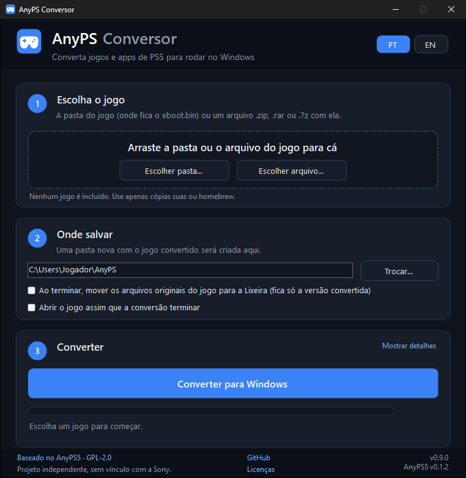

# AnyPS5 Conversor

[](https://github.com/LeoFeitosa/anyps5-conversor/actions/workflows/build.yml)
[](https://github.com/LeoFeitosa/anyps5-conversor/releases/latest)
[](LICENSE)

Interface gráfica para Windows que converte jogos e apps de PS5 em executáveis do Windows, sem
linha de comando. Você escolhe a pasta do jogo, clica em **Converter para Windows** e, no fim,
em **Jogar agora**.

**Português** | [English](README.en.md)

**[⬇ Baixar a versão mais recente (AnyPS5-Conversor.exe)](https://github.com/LeoFeitosa/anyps5-conversor/releases/latest/download/AnyPS5-Conversor.exe)**



## Baseado no AnyPS5

Este projeto é uma interface para o [AnyPS5](https://github.com/boykopovar/AnyPS5), de
[boykopovar](https://github.com/boykopovar) e colaboradores. Todo o trabalho pesado é deles: o
relinker que transforma o executável do PS5 num executável nativo e as bibliotecas do sistema
reimplementadas. O AnyPS5 Conversor só junta essas peças num programa que qualquer pessoa consegue
usar:

| Parte | Origem |
|---|---|
| Relinker (`relinker.exe`) | Release oficial do AnyPS5, embutido sem alterações |
| Bibliotecas para Windows (`libs/`) | Release oficial do AnyPS5 (`prx-windows`), embutidas sem alterações |
| Desembrulho de SELF | Porte para C# de [`tools/unwrap_self.py`](https://github.com/boykopovar/AnyPS5/blob/main/tools/unwrap_self.py) do AnyPS5 |
| Interface, idiomas e montagem da pasta final | Este repositório |

A versão do AnyPS5 usada em cada build fica fixada em [`build/dependencies.json`](build/dependencies.json),
com o hash SHA-256 de cada arquivo. Uma cópia de segurança desses arquivos fica num release interno deste
repositório (`anyps5-<versão>`), usada só se o release oficial deixar de existir.

## Como usar

1. [Baixe o `AnyPS5-Conversor.exe`](https://github.com/LeoFeitosa/anyps5-conversor/releases/latest/download/AnyPS5-Conversor.exe) (sempre a versão mais recente; versões anteriores ficam em
   [Releases](https://github.com/LeoFeitosa/anyps5-conversor/releases)).
2. Abra o programa. Não precisa instalar nada.
3. Arraste o jogo para a janela, ou use **Escolher pasta** ou **Escolher arquivo**. Pode ser a pasta
   onde fica o `eboot.bin` ou um arquivo `.zip`, `.rar`, `.7z`, `.tar`, `.tar.gz`, `.tgz`, `.bz2` ou
   `.xz` com ela dentro. Se o arquivo tiver senha, o programa pede. Não precisa ter 7-Zip
   ou WinRAR instalado.
4. Clique em **Converter para Windows** e depois em **Jogar agora**.

Se quiser ficar só com a versão convertida, marque **Ao terminar, mover os arquivos originais do jogo
para a Lixeira**. Eles vão para a Lixeira do Windows, de onde podem ser restaurados.

Arquivos compactados são extraídos no próprio local escolhido em "Onde salvar" (numa pasta oculta,
apagada ao final), então salvar em outro disco também tira a extração do C:.

O jogo convertido fica numa pasta nova, por padrão em `%USERPROFILE%\AnyPS5\<nome do jogo>`, com o
executável, a pasta `libs/` e os arquivos originais em `app0/`. A pasta pode ser movida para
qualquer lugar.

Também dá para arrastar a pasta do jogo direto sobre o ícone do `AnyPS5-Conversor.exe`.

## Requisitos

- Windows 10 (versão 1607 ou mais nova) ou Windows 11, 64 bits. É o mínimo das bibliotecas do AnyPS5
  para os jogos convertidos rodarem, e também o do .NET 10, com que o conversor é feito.
- Processador com AVX2, FMA, F16C, BMI1, BMI2, LZCNT e MOVBE (Ryzen e Intel Core a partir de 2015,
  em geral). O programa avisa se faltar alguma. Em processadores Intel a conversão usa
  automaticamente a opção `--to-intel` do AnyPS5.
- Placa de vídeo com driver Vulkan atualizado.
- O jogo precisa estar **descriptografado**. Arquivos criptografados são recusados, assim como pacotes
  `.pkg` da loja, que são criptografados.

Quando uma conversão falha, o registro dela fica em `%LOCALAPPDATA%\AnyPS5-Conversor\logs` (os 10
mais recentes, por até 30 dias). Fora isso o programa só guarda o idioma e a pasta escolhidos e apaga os
temporários ao terminar. Se um jogo converte mas não abre ou trava, quase sempre é uma função do sistema que o AnyPS5 ainda
não implementa. O progresso por título fica no
[mapa de compatibilidade](https://alxcbtw.github.io/anyps5-roadmap/) e os relatos vão nas
[discussões do AnyPS5](https://github.com/boykopovar/AnyPS5/discussions/categories/game-bring-up).

## Compilar

Requisitos: [.NET SDK 10](https://dotnet.microsoft.com/download) e PowerShell 7.

```powershell
pwsh build/download-dependencies.ps1
dotnet test
dotnet publish src/AnyPS5Conversor -c Release -o publish
```

O resultado é um único `publish/AnyPS5-Conversor.exe`, com o runtime do .NET, o relinker e as
bibliotecas embutidos. Os builds oficiais são feitos pelo GitHub Actions a cada tag `vX.Y.Z` e
publicados em Releases junto com o SHA-256.

Detalhes sobre versões, commits e testes estão em [CONTRIBUTING.md](CONTRIBUTING.md). O histórico
de mudanças está em [CHANGELOG.md](CHANGELOG.md), e como relatar falhas de segurança, em
[SECURITY.md](SECURITY.md).

## Aviso legal

- Este projeto não inclui, distribui nem ajuda a obter jogos, firmware, chaves ou bibliotecas
  proprietárias. Use apenas jogos que você extraiu do seu próprio console ou homebrew de
  distribuição livre.
- O programa não quebra nenhuma proteção: ele só aceita executáveis que já estão descriptografados.
- Projeto independente, sem vínculo com a Sony Interactive Entertainment nem com os autores do
  AnyPS5. PlayStation e PS5 são marcas da Sony Interactive Entertainment, citadas aqui apenas para
  descrever compatibilidade.
- Fornecido "como está", sem garantia. Cada usuário responde pelo uso que faz e pelo cumprimento das
  leis do seu país.

O texto completo, com marcas, licenças de terceiros e como pedir a remoção de conteúdo, está em
[LEGAL.md](LEGAL.md).

## Licença

[GNU General Public License v2.0](LICENSE), a mesma do AnyPS5. O executável distribui o relinker e
as bibliotecas do AnyPS5, cujo código-fonte está em
[boykopovar/AnyPS5](https://github.com/boykopovar/AnyPS5) (na tag fixada em `build/dependencies.json`),
e o deste programa, aqui. Os componentes de terceiros e suas licenças estão em
[THIRD-PARTY-NOTICES.txt](THIRD-PARTY-NOTICES.txt).
